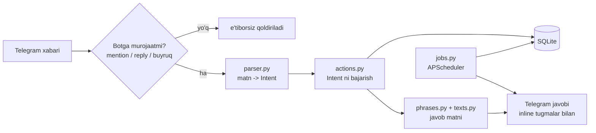

# bopqoldibot

[](https://github.com/aFeruz/bopqoldibot/actions/workflows/tests.yml)


Telegram guruhlar uchun jamoaviy kundalik bot. Guruhga admin qilinadi va oddiy o'zbek tilida yozilgan
xabarlarni tushunadi: vazifalarni yozib boradi, bajarilganini belgilaydi, mijozlar bilan kim qachon
ishlaganini qayd qiladi, eslatmalar va takroriy vazifalarni o'zi yuboradi.

Bot sun'iy intellekt xizmatlariga bog'liq emas. Matnni tushunish qoidalarga asoslangan parser orqali
amalga oshiriladi: u lotin va kirill yozuvini, sinonimlarni, tartib so'zlarini ("uchinchisi"), nisbiy
vaqtni ("yarim soatdan keyin", "ertaga kechqurun") va xatolik bilan yozilgan ismlarni taniydi.

---

## Mundarija

- [Imkoniyatlar](#imkoniyatlar)
- [Ishlash tamoyili](#ishlash-tamoyili)
- [O'rnatish](#ornatish)
- [Sozlamalar](#sozlamalar)
- [Foydalanish](#foydalanish)
- [Avtomatik xabarlar](#avtomatik-xabarlar)
- [Loyiha tuzilmasi](#loyiha-tuzilmasi)
- [Ishlab chiqish](#ishlab-chiqish)
- [Ma'lumotlar va zaxira nusxa](#malumotlar-va-zaxira-nusxa)

---

## Imkoniyatlar

**Zametkalar va vazifalar**

- Erkin matndan zametka yaratish; kategoriya (`#teg`), muhimlik (`!`), muddat va mas'ul (`@username`) bilan
- Raqam, tartib so'zi ("ikkinchisi"), "oxirgisi" yoki matn bo'yicha bajarildi deb belgilash
- Bot xabariga javob (reply) orqali boshqarish: `bo'ldi`, `o'chir`
- Qayta ochish, tahrirlash, o'chirish, kategoriyaga ko'chirish, muddatni surish, mas'ul biriktirish
- Ro'yxatlar: ochiq, bajarilgan, bugungi, ertangi, muhim, muddati o'tgan, kategoriya va mas'ul bo'yicha
- Matn bo'yicha qidiruv
- Rasm, ovozli xabar, video, audio, video-xabar va fayllarni zametka sifatida saqlash (kategoriya, mas'ul,
  izoh bilan) va keyin kategoriya yoki turi bo'yicha qayta yuborish

**Mijozlar**

- Bittalab yoki ommaviy kiritish (har qatorda ism, telefon, kategoriya, izoh)
- Aloqalarni qayd qilish ("Ali bilan gaplashdim", "Valiga taklif yubordim") va ularning tarixi
- Ishlangan va ishlanmagan mijozlar ro'yxati, davr va kategoriya bo'yicha filtr
- Mijoz kartochkasi, telefon, izoh va kategoriyani tahrirlash, arxivlash
- Aloqa izohida vaqt ko'rsatilsa ("3 kundan keyin qayta qo'ng'iroq"), avtomatik eslatma
- Excel (`.xlsx`) va CSV fayldan import: ustunlar sarlavha bo'yicha avtomatik aniqlanadi, Meta Lead Ads
  eksporti to'g'ridan-to'g'ri qabul qilinadi, dublikatlar telefon bo'yicha tekshiriladi, importni bekor qilish mumkin
- Mijozlarni mas'ulga biriktirish (ism, raqam, kategoriya yoki "barcha" / "ishlanmaganlar" bo'yicha), mas'ulni
  Telegram orqali xabardor qilish va ishlanmaguncha har kuni ertalab eslatish

**Rejalashtirish va hisobotlar**

- Bir martalik eslatmalar va muddat kelganda xabar (bajarildi, bir soatga surish, ertaga o'tkazish tugmalari bilan)
- Takroriy vazifalar: har kuni, ish kunlari, haftaning ma'lum kuni, oyning ma'lum sanasi
- Kun rejasi, kundalik (bugun / kecha / hafta), statistika, kategoriyalar bo'yicha hisob
- Ertalabki reja, kechki kundalik va haftalik hisobotni avtomatik yuborish
- CSV eksport (zametkalar, mijozlar, aloqalar; Excel bilan mos)

**Muloqot**

- Har bir javob tasodifiy tanlangan iboralardan tuziladi, bir xil javob ketma-ket takrorlanmaydi
- Salomga alik olish, minnatdorchilik va xayrlashuvga javob; gap boshidagi suhbat qismi
  ("rahmat yaxshi, Assalomu alaykum, nima bor bugunga?") ajratilib, avval unga, keyin so'rovga javob beriladi
- Bot xabariga reply kontekst bilan tushuniladi: zametka kartochkasiga `muhim`, mijoz kartochkasiga
  `gaplashdim`, eslatmaga `10 minutdan keyin yana eslat`
- Tasdiq (`ok`, `xo'p`), kulgi, emoji, stiker, ovozli xabar, "bormisan", soat va sana, latifa va
  motivatsiya so'rovlariga javob; savol ko'rinishidagi xabarlar zametka emas, qidiruv sifatida ko'riladi
- Tushunilmagan reply jim qoldirilmaydi: bot uni zametka sifatida saqlashni taklif qiladi
- Har bir guruhning ma'lumotlari alohida saqlanadi; shaxsiy chatda shaxsiy kundalik sifatida ishlaydi

---

## Ishlash tamoyili



Guruhda bot faqat quyidagi xabarlarga javob beradi:

| Holat | Misol |
|---|---|
| Bot tag qilingan | `@bopqoldibot tovar sanash kerak` |
| Bot xabariga javob (reply) | bot yozgan zametkaga `bo'ldi` |
| Slash buyruq | `/notes` |
| Shaxsiy chat | istalgan matn |

Botning xabariga oddiy javob (masalan, "rahmat") zametka sifatida saqlanmaydi.

---

## O'rnatish

### Talablar

- Python 3.12 yoki Docker
- @BotFather orqali olingan bot tokeni

### Telegram tomonida

1. @BotFather: `/newbot` buyrug'i bilan bot yarating va tokenni oling.
2. Botni guruhga qo'shing va **administrator** qiling. Shundagina bot javob (reply) xabarlarini
   ko'radi. Muqobil yo'l: @BotFather'da `/setprivacy` orqali privacy rejimini o'chirish.

### Docker orqali (tavsiya etiladi)

```bash
git clone https://github.com/aFeruz/bopqoldibot.git
cd bopqoldibot
cp .env.example .env        # BOT_TOKEN ni kiriting
docker compose up -d --build
docker compose logs -f
```

### Lokal ishga tushirish

```bash
python3.12 -m venv .venv
.venv/bin/pip install -r requirements.txt
cp .env.example .env        # BOT_TOKEN ni kiriting
.venv/bin/python -m bot
```

### Test va prod muhitlari

Har bir muhit o'z tokeni, o'z bazasi va o'z Docker loyihasi bilan ishlaydi:

```bash
# test
docker compose up -d --build

# prod
cp .env.example .env.prod   # prod bot tokeni
ENV_FILE=.env.prod DATA_DIR=./data-prod docker compose -p bopqoldibot-prod up -d --build
```

`.env*` fayllari va `data*/` papkalari git'ga tushmaydi.

---

## Sozlamalar

Barcha sozlamalar muhit o'zgaruvchilari yoki `.env` fayli orqali beriladi.

| O'zgaruvchi | Standart qiymat | Tavsif |
|---|---|---|
| `BOT_TOKEN` | — | Telegram bot tokeni (majburiy) |
| `DB_PATH` | `data/bot.db` | SQLite fayli yo'li |
| `TZ` | `Asia/Tashkent` | Vaqt zonasi; muddatlar va hisobotlar shu bo'yicha hisoblanadi |
| `MORNING_SUMMARY_HOUR` | `9` | Ertalabki reja soati |
| `DAILY_SUMMARY_HOUR` | `20` | Kechki kundalik soati |

Guruh darajasidagi sozlamalar (avtomatik xabarlarni yoqish/o'chirish) botning o'zida:
`@bopqoldibot sozlamalar` yoki `/settings`.

---

## Foydalanish

Quyidagi misollarda bot tag qilingan deb hisoblanadi (`@bopqoldibot ...`). To'liq ro'yxat botning o'zida:
`yordam` yoki `/help`.

### Zametkalar

| Xabar | Natija |
|---|---|
| `tovar sanash kerak` | Yangi zametka |
| `! #ombor ertaga kechqurun inventarizatsiya` | Muhim, `ombor` kategoriyasida, muddati ertaga 19:00 |
| `@ali yuk tushirish soat 15:00` | `@ali` ga biriktirilgan, muddatli zametka |
| `iltimos, kassani tekshirish deb yozib qo'y` | Zametka: "kassani tekshirish" |
| `nima ishlar bor`, `ro'yxatni ko'rsat`, `#ombor` | Ochiq zametkalar ro'yxati |
| `bajarilganlar`, `bugungi`, `muhimlar`, `muddati o'tganlar` | Filtrlangan ro'yxatlar |
| `mening ishlarim`, `@ali ishlari` | Mas'ul bo'yicha ro'yxat |
| `3 bo'ldi`, `3, 5 bajarildi`, `uchinchisi tayyor`, `oxirgisi bo'ldi` | Bajarildi deb belgilash |
| `hisobotni tugatdim` | Matn bo'yicha topib, bajarildi deb belgilash |
| `3 ni qaytar`, `3 o'chir`, `3 tuzat: yangi matn` | Qayta ochish, o'chirish, tahrirlash |
| `3 ni #ombor ga o'tkaz`, `3 muhim`, `3 ni ertaga sur`, `3 ni @vali ga ber` | Zametkani o'zgartirish |
| `tovarni qidir` | Qidiruv |
| boshqa xabarga reply qilib `@bopqoldibot` | O'sha xabar zametka sifatida saqlanadi |

### Fayllar

| Xabar | Natija |
|---|---|
| media xabarga reply qilib `@bopqoldibot eslab qol #shartnoma` | Fayl zametka sifatida saqlanadi |
| izohi `@bopqoldibot #shartnoma imzolangan nusxa` bo'lgan rasm yoki fayl | Shu izoh bilan saqlanadi |
| `#shartnoma fayllari`, `rasmlar`, `ovozli xabarlar`, `hujjatlar` | Ro'yxat va yuklab olish tugmalari |
| `fayllarni tashla #shartnoma`, `ovozli xabarlarni tashla` | Fayllarning o'zi yuboriladi (oxirgi 10 ta) |
| `3 ni tashla`, bot yuborgan faylga reply qilib `o'chir` | Bitta faylni olish yoki boshqarish |

Bot fayllarni yuklab olmaydi va serverda saqlamaydi: Telegram bergan `file_id` saqlanadi va fayl shu
identifikator orqali qayta yuboriladi. Jadval fayllari (`.xlsx`, `.csv`) odatda import qilinadi; izohda
`saqla` yoki `eslab qol` bo'lsa, oddiy fayl sifatida saqlanadi.

### Mijozlar

| Xabar | Natija |
|---|---|
| `mijoz qo'sh: Ali, Vali #vip` | Ikki mijoz `vip` kategoriyasida |
| `mijozlar qo'sh:` va keyingi qatorlarda `Ism +99890... #kategoriya \| izoh` | Ommaviy kiritish |
| `Ali bilan ishladim narx kelishildi` | Aloqa izoh bilan qayd qilinadi |
| `Valiga qo'ng'iroq qildim`, `Sardorga taklif yubordim` | Aloqa qayd qilinadi |
| `Ali bilan gaplashdim, 3 kundan keyin qayta qo'ng'iroq` | Aloqa va avtomatik eslatma |
| `kimlar qoldi`, `bu hafta ishlanmaganlar #vip` | Ishlanmagan mijozlar |
| `bugun kimlar bilan ishladik` | Ishlangan mijozlar |
| `Ali haqida`, `mijoz 5` | Mijoz kartochkasi va aloqalar tarixi |
| `Ali telefoni +99890...`, `Ali izoh: ...`, `Ali ni #vip ga o'tkaz` | Mijozni tahrirlash |
| `mijoz 5 o'chir` | Arxivlash |

Topilmagan ism uchun bot yangi mijoz qo'shishni taklif qiladi; bir nechta mos kelsa, tanlash uchun tugmalar chiqaradi.

### Mas'ul biriktirish

| Xabar | Natija |
|---|---|
| `mijoz qo'sh: Ali, Vali, @sardor ga o'tkaz, eslatib tur` | Qo'shish, biriktirish va har kungi eslatma |
| `Ali, Vali ni @sardor ga o'tkaz` | Mavjud mijozlarni biriktirish |
| `#rangor mijozlarini @sardor ga ber, ertaga 10 da eslat` | Kategoriya bo'yicha, bir martalik eslatma bilan |
| `ishlanmaganlarni @sardor ga ber`, `barcha mijozlarni @sardor ga ber` | Guruh bo'yicha biriktirish |
| `@sardor mijozlari`, `@sardor ishlanmaganlari`, `mening mijozlarim` | Mas'ul bo'yicha ro'yxatlar |

"Eslatib tur" so'zi bilan biriktirilgan mijozlar bo'yicha mas'ulga har kuni ertalab ro'yxat yuboriladi.
Mijoz bilan aloqa qayd qilinishi bilan u ro'yxatdan chiqadi.

### Excel va CSV import

Faylni guruhga yuboring. Izohda bot tag qilinsa, darhol import qilinadi; aks holda bot import qilishni
tugma orqali taklif qiladi. Shaxsiy chatda har qanday jadval import qilinadi. Allaqachon yuborilgan faylga
javob (reply) qilib `@bopqoldibot kirit` deb yozish ham mumkin.

Izohda quyidagilarni ko'rsatish mumkin: `#kategoriya`, `@masul`, `@masul ga o'tkaz, eslatib tur`,
`ertaga 10 da eslat`.

| Aniqlanadigan maydon | Sarlavha namunalari |
|---|---|
| Ism | `Ism`, `Mijoz`, `Name`, `Full name`, `ФИО`, `полное_имя` |
| Telefon | `Telefon`, `Phone`, `Номер`, `номер_телефона` (`p:` prefiksi va 9 xonali raqamlar to'g'rilanadi) |
| Kategoriya | `Kategoriya`, `Category`, `Segment` |
| Izoh | `Izoh`, `Comment`, `Примечание`, sarlavhasiz qo'shimcha ustunlar |
| Qiziqish | savol ko'rinishidagi sarlavha (`nimani ijaraga berasiz?`) |
| Holat | `Status`, `lead_status` (standart `CREATED` qiymati e'tiborga olinmaydi) |
| Manba | `platform`, `ad_name`, `Manba` |
| Sana | `created_time`, `Sana`, `Date` |
| Mas'ul | `Mas'ul`, `Manager`, `Менеджер` |

Sarlavha topilmasa, birinchi ustun ism, telefonga o'xshagan ustun telefon deb olinadi. Meta test lidlari
o'tkazib yuboriladi. Import natijasi ostidagi tugma orqali butun importni bekor qilish mumkin; aloqa qayd
qilingan mijozlar bunda saqlab qolinadi.

### Eslatmalar va takroriy vazifalar

| Xabar | Natija |
|---|---|
| `eslat ertaga 9:00 hisobot` | Bir martalik eslatma |
| `hisobotni kechqurun eslat`, `esimga sol yarim soatdan keyin choy` | Bir martalik eslatma |
| `har kuni 9 da kassani tekshirish` | Har kuni 09:00 da zametka yaratiladi |
| `har ish kuni 18:00 da kassa yopish` | Dushanba–juma |
| `har dushanba hisobot`, `har oyning 5-sanasida ijara` | Haftalik / oylik |
| `eslatmalar`, `takroriylar` | Ro'yxat va bekor qilish tugmalari |

### Hisobotlar

| Xabar | Natija |
|---|---|
| `kun rejasi` | Bugungi, muddati o'tgan, muhim ishlar va 7 kundan beri gaplashilmagan mijozlar |
| `kundalik`, `kecha nima qildik`, `haftalik xulosa` | Davr bo'yicha kundalik |
| `statistika`, `qalay ketyapmiz` | Statistika va eng faol ishtirokchilar |
| `kategoriyalar` | Kategoriyalar bo'yicha hisob |
| `excel qilib ber` | CSV fayllar |

### Slash buyruqlar

| Buyruq | Tavsif | Buyruq | Tavsif |
|---|---|---|---|
| `/note` | Zametka qo'shish | `/notworked` | Ishlanmagan mijozlar |
| `/notes` | Ochiq zametkalar | `/workedlist` | Ishlangan mijozlar |
| `/done` | Bajarildi deb belgilash | `/card` | Mijoz kartochkasi |
| `/done_list` | Bajarilganlar | `/archive` | Mijozni arxivlash |
| `/undo` | Qayta ochish | `/categories` | Kategoriyalar |
| `/del` | O'chirish | `/stats` | Statistika |
| `/edit` | Tahrirlash | `/diary` | Kundalik |
| `/find` | Qidirish | `/remind` | Eslatma qo'yish |
| `/client` | Mijoz qo'shish | `/reminders` | Eslatmalar |
| `/clients` | Mijozlar | `/export` | CSV eksport |
| `/worked` | Mijoz bilan ishlandi | `/my` | Mening ishlarim |
| `/agenda` | Kun rejasi | `/recurring` | Takroriy vazifalar |
| `/settings` | Sozlamalar | `/help` | Yordam |

---

## Avtomatik xabarlar

| Xabar | Vaqt | Standart holat |
|---|---|---|
| Muddat kelganda ogohlantirish | zametka muddatida | yoqilgan |
| Bir martalik eslatma | belgilangan vaqtda | har doim |
| Takroriy vazifa | qoidaga ko'ra | har doim |
| Ertalabki reja | `MORNING_SUMMARY_HOUR` | o'chirilgan |
| Mas'ulga ishlanmagan mijozlar ro'yxati | `MORNING_SUMMARY_HOUR` + 5 daqiqa | "eslatib tur" bilan biriktirilganda |
| Kechki kundalik | `DAILY_SUMMARY_HOUR` | o'chirilgan |
| Haftalik hisobot | juma, 18:00 | o'chirilgan |

Fon vazifalari har 30 soniyada tekshiriladi. Bot vaqtincha to'xtagan bo'lsa, o'tib ketgan eslatmalar va
shu kungi takroriy vazifalar qayta ishga tushganda yuboriladi.

---

## Loyiha tuzilmasi

```
bot/
  __main__.py          kirish nuqtasi: dispatcher, middleware, scheduler
  config.py            muhit o'zgaruvchilari (pydantic-settings)
  db.py                ulanish va avtomatik sxema migratsiyasi
  models.py            SQLAlchemy modellari
  parser.py            matn -> Intent (lug'at, sana/vaqt, sonlar)
  phrases.py           javob iboralari bazasi
  texts.py             xabarlarni formatlash
  keyboards.py         inline tugmalar
  jobs.py              fon vazifalari
  media.py             media turini aniqlash, tavsiflash va qayta yuborish
  handlers/
    mention.py         mention va reply'larni aniqlash
    commands.py        slash buyruqlar
    callbacks.py       inline tugmalar bosilishi
    files.py           media va fayllarni qabul qilish: saqlash yoki jadval importi
    actions.py         Intent ni bajarish (barcha kirish yo'llari uchun umumiy)
    context.py         bot xabariga reply: zametka / mijoz / eslatma kontekstini aniqlash
  services/
    notes.py           zametkalar
    clients.py         mijozlar va aloqalar
    recurring.py       takroriy vazifalar
    reminders.py       eslatmalar va guruh sozlamalari
    reports.py         statistika, kundalik, eksport
    importer.py        jadvaldan mijozlarni o'qish (ustunlarni aniqlash, tozalash)
    common.py          vaqt zonasi, davrlar, kategoriyalar
tests/                 parser, oqim va fon vazifalari testlari
```

### Ma'lumotlar modeli

| Jadval | Mazmuni |
|---|---|
| `notes` | Zametkalar: guruh ichidagi raqam, matn, holat, kategoriya, muddat, mas'ul, biriktirilgan fayl |
| `clients` | Mijozlar: raqam, ism, telefon, izoh, kategoriya, mas'ul, eslatish belgisi, import partiyasi |
| `interactions` | Mijozlar bilan aloqalar tarixi |
| `categories` | Guruh kategoriyalari (zametka va mijozlar uchun umumiy) |
| `reminders` | Bir martalik eslatmalar |
| `recurring` | Takroriy vazifalar qoidalari |
| `chat_settings` | Guruhning avtomatik xabar sozlamalari |

---

## Ishlab chiqish

```bash
.venv/bin/pip install -r requirements-dev.txt
.venv/bin/python -m pyflakes bot tests
.venv/bin/python -m pytest -q
```

Testlar Telegram'ga ulanmaydi: xabarlar soxta obyektlar bilan, baza esa xotiradagi SQLite bilan
almashtiriladi. Har bir push va pull request GitHub Actions'da tekshiriladi.

### Botga yangi ibora o'rgatish

| Nima qo'shiladi | Qayerga |
|---|---|
| "bajarildi", "o'chir", "mijoz bilan ishlandi" sinonimlari | `bot/parser.py`: `DONE_WORDS`, `DEL_WORDS`, `WORKED_WORDS` va boshqalar |
| Yangi buyruq turi | `bot/parser.py` (`Intent`) va `bot/handlers/actions.py` (`_execute`) |
| Javob iboralari, murojaat so'zlari | `bot/phrases.py`: `POOL`, `ADDRESSES` |

Har bir yangi ibora uchun `tests/test_corpus.py` dagi `CASES` (to'g'ri tushunilishi kerak bo'lgan gaplar)
yoki `TRICKY` (yanglish tushunilmasligi kerak bo'lgan gaplar) ro'yxatiga misol qo'shish tavsiya etiladi.
Shu faylda botning har qanday xabariga qilingan reply javobsiz qolmasligi ham tekshiriladi.

### Sxemani o'zgartirish

Modelga yangi ustun qo'shilsa, u ishga tushganda mavjud bazaga avtomatik qo'shiladi (`bot/db.py`).
Eski yozuvlar uchun alohida qiymat kerak bo'lsa, ustunga `info={"migrate_default": ...}` beriladi.
Ustunni o'chirish yoki nomini o'zgartirish qo'lda migratsiyani talab qiladi.

---

## Ma'lumotlar va zaxira nusxa

Barcha ma'lumotlar bitta SQLite faylida (`data/bot.db`) saqlanadi. Ishlayotgan bot uchun xavfsiz zaxira nusxa:

```bash
sqlite3 data/bot.db ".backup 'backups/bot-$(date +%F).db'"
```

Tiklash uchun botni to'xtatib, faylni `data/bot.db` o'rniga qo'yish kifoya.
